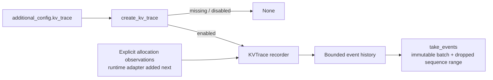

# KV Trace: Incremental Development

!!! note "Component foundation; no runtime instrumentation yet"
    This first slice provides a recorder and configuration factory. Scheduler,
    block-pool and worker integration are not enabled by this change. Passing
    `additional_config.kv_trace` to an engine does not yet activate monitoring.

KV Trace will connect native KV-cache lifecycle observations with request
bindings and runner address plans. Build and review it in small contributions
whose behavior can be tested independently.

## First slice: collection foundation

`vllm/v1/kv_trace.py` has one concrete recorder, two immutable data records, and
an opt-in factory. It introduces no generic plugin framework, abstract backend,
background thread, device operation, or scheduler method wrapper.

| Component | Responsibility |
| --- | --- |
| `BlockAllocated` | Record sequence, pool, block ID and observed allocation generation. |
| `KVTrace` | Assign engine-local trace identity, sequence and allocation generations; retain at most 4,096 events by default. |
| `KVTraceBatch` | Return detached immutable events and the half-open range of events lost to retention overflow. |
| `create_kv_trace` | Parse `additional_config["kv_trace"]["enabled"]`; return no recorder when omitted or disabled. |

The factory accepts only a boolean `enabled` option. Unknown options and wrong
types fail explicitly, including when tracing is disabled. The retention limit
is an internal constructor parameter rather than another engine configuration
option in this first slice.

An allocation generation advances only when the caller reports a new native
allocation lifetime. Prefix sharing must not call `record_allocation`. Draining
events preserves generations and sequence numbers. Identical block IDs in
different pools, or in different recorder instances, have separate identities.
Callers must assign stable pool IDs within one recorder's lifetime.

This component records observations; it does not decide whether the allocator
acted correctly. It tracks neither native reference counts nor initialized KV
contents. Missing history is reported as a gap, not reconstructed from later
allocations.

The recorder has one producer and consumer in the same engine thread. Retained
event count is bounded; the generation table grows with the number of distinct
pool/block identities observed. This is not a process-memory byte budget.
Concurrency, pool teardown and export policies need review when their runtime
integration is introduced.

## Design standards applied

The implementation follows specific patterns from reviewed upstream changes:

| Reference | Useful pattern | Application here |
| --- | --- | --- |
| [KV offload RFC](https://github.com/vllm-project/vllm/issues/19854), [component PR](https://github.com/vllm-project/vllm/pull/19848), [LRU follow-up](https://github.com/vllm-project/vllm/pull/20075) | Deliver a testable component before adding policy and runtime integration. | Start with real bounded collection and drain behavior; add native producers separately. |
| [Endpoint plugin RFC](https://github.com/vllm-project/vllm/issues/46565), [implementation](https://github.com/vllm-project/vllm/pull/47454) | Keep the contract, opt-in gate and lifecycle explicit; exercise behavior at the appropriate entry point. | The factory is the component entry point; disabled tracing returns `None`, and real recorder objects test its behavior. |
| [Connector event extension](https://github.com/vllm-project/vllm/pull/19737) | Extend through a small `take_events` contract and cover composition points. | Collection has a typed drain boundary. Scheduler/worker/composite adapters must bring their own integration tests. |

These are code-organization references, not dependencies or implementations of
KV Trace. Their abstraction counts are not a template: a single recorder does
not need an abstract base class, handler registry or sink factory hierarchy.

## Tests and next contributions

`tests/v1/core/test_kv_trace.py` exercises the factory, engine/pool isolation,
reallocation after drain, bounded retention, exact dropped-sequence reporting,
and detachment from mutable input. It uses real recorder instances and does
not patch native vLLM components. Existing V1 Core CI selects this directory.

1. **Collection foundation:** the component in this change. No claim of serving
   reachability, hardware coverage or model-output validation.
2. **Native allocator observations:** wire allocation and reference boundaries,
   identify pools and teardown, and test cache sharing/reuse on the real path.
3. **Request history:** add scheduler binding deltas and scheduling-step context,
   with completion/preemption semantics and bounded export.
4. **MRV2 plans:** correlate final metadata once per cache group, including
   asynchronous snapshots and eager/FULL replay. No per-layer attention tracing.
5. **Diagnostics and coverage:** add supported address checks and then explicit
   layout/connector adapters, each with targeted runtime evidence.

Each contribution must describe its actual producer and consumer, disabled
cost, ownership/lifetime semantics, tests and remaining coverage. Runtime
activation and fail-fast policies are not implied by the collection foundation.
