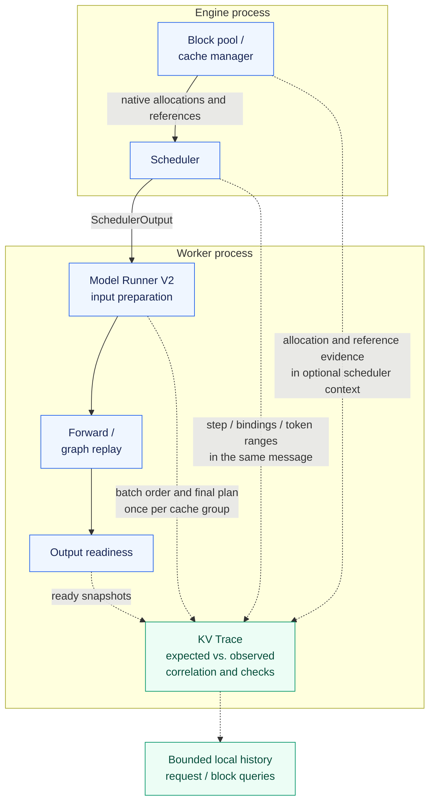
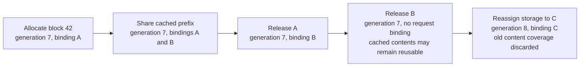
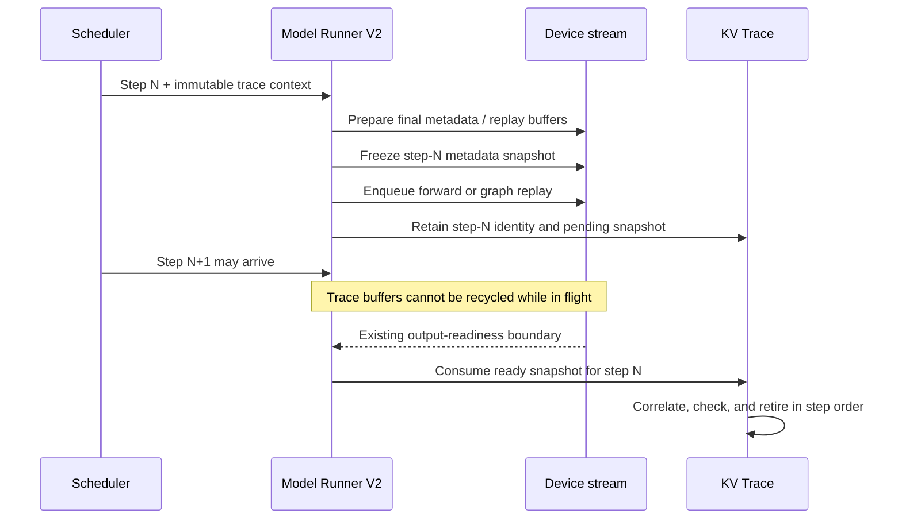

# KV Trace Monitoring Design

!!! note "Proposal, not an available upstream feature"
    This document proposes an opt-in debugging facility for vLLM.
    It adds no runtime implementation or configuration field.
    The integration points and first implementation scope need maintainer review.

KV Trace connects a request's scheduling history, the lifetimes of its physical
KV blocks, and the address plans submitted by the model runner. A developer
should be able to follow a request or block across these boundaries and inspect
the earliest recorded disagreement.

The design discussion is tracked in [RFC #66942](https://github.com/vllm-project/vllm/issues/66942).
The author's [vllm-ascend PR #17833](https://github.com/vllm-project/vllm-ascend/pull/17833)
is a reference implementation of address checks, not an upstream implementation
of the complete trace history proposed here.

## Problem

A block can be allocated and still be the wrong destination for a token.
Suppose request A is bound to block 41 and request B to block 42. If their
write slots are exchanged, both addresses remain inside allocated memory.
An allocation log does not establish which request was intended to write there.

Investigating this case requires three independently sourced views:

| View | Question it answers |
| --- | --- |
| Scheduler | Which logical tokens and block bindings were assigned to each request? |
| Block pool | Which allocation lifetime does a block ID identify, and when did references change? |
| Model runner | Which request order, block tables, slots, and sequence lengths were supplied to execution? |

These views are harder to connect after preemption, prefix sharing, block reuse,
batch reordering, or asynchronous output retrieval. Repeated or incorrect text
alone does not prove a KV-cache fault. The swapped-slot case above is an
illustration; a minimized natural-failure replay on upstream remains to be added.

## Goals and scope

The first contribution should cover Model Runner V2, decoder-only dense paged
attention, one device, eager and FULL graph execution, with prefix caching on
and off. It should provide bounded structured history and compare independently
scheduled destinations with final address metadata once per KV cache group.

There is no per-layer attention instrumentation. Shared metadata is collected
once per group and step; a backend with distinct address plans within a group
needs an explicit adapter or an incomplete-coverage record.

Connectors, speculation, context/pipeline/tensor parallelism, MLA, sliding-window
or circular caches, and recurrent-state layouts need separate coverage work.
An unsupported observation path must be visible as a gap without changing valid
inference behavior in the default logging mode.

This proposal does not include KV tensor dumps, kernel memory-access tracing,
numerical correctness checks, automatic repair, a distributed trace service,
or a graphical trace viewer. The first consumer is a local trace file that can
be filtered by request and block identity.

## Architecture

Solid arrows are the native execution path. Dashed arrows carry optional
observations. The monitor observes native decisions and does not allocate,
release, or reschedule KV storage.



### Native integration points

These are proposed observation sites in the current source, not new public
callback names or a generic plugin API.

| Boundary | Existing source | Proposed observation |
| --- | --- | --- |
| Allocation and references | `vllm/v1/core/block_pool.py`: `get_new_blocks`, `touch`, `free_blocks`, `unpin_blocks`, cache reset | Allocation identity, native reference transitions, reuse and invalidation. |
| Request bindings | `vllm/v1/core/kv_cache_manager.py` and `vllm/v1/core/sched/scheduler.py` | Request-to-logical-block changes, scheduling ranges, preemption and finish. |
| Process handoff | `vllm/v1/core/sched/output.py`: `SchedulerOutput` | Optional immutable context sent with the native scheduling message. |
| Execution metadata | `vllm/v1/worker/gpu/model_runner.py`: `execute_model`, `prepare_attn`, `model_state.prepare_attn` | Final real-step batch order, read ranges, block tables and slot mappings after backend preparation. |
| Output readiness | Runner's existing asynchronous result path | Retire observations for the original step when its snapshot is ready. |

Use explicit optional observer calls at these boundaries. Keep collection and
checking logic in a separate module; disabled tracing should allocate no trace
buffers, copy no metadata, and emit no records. No class replacement or method
wrapping is proposed upstream.

`BlockPool` already has reuse watchers for unpinned blocks. They are one-shot
ownership callbacks, not a complete allocation/reference event stream; tracing
must not replace or consume another component's callback. Likewise, native
cache-publication events can provide useful evidence but do not contain the
complete request bindings and execution address plans needed here.

The Ascend reference currently wraps scheduler and cache methods. Native
allocation observations and a reviewed `SchedulerOutput` context would replace
that integration. The reference's wrapper mechanism is not proposed as the
upstream API.

## Identity and lifecycle

A numeric block ID is insufficient after reuse. Correlate records using the
engine instance, process/rank, pool, physical block ID and allocation generation.
Identify a logical binding separately by request incarnation, cache group and
logical block index. Cache groups can share a physical pool; they do not create
independent lifetimes for the same physical block.

Advance the generation when the native allocator hands storage out for a new
lifetime. A prefix-cache hit through `touch` preserves the existing generation,
including when the cached block had no live request references. Request-ID
reuse must also be distinguishable within one engine session.

Track separate facts rather than assigning a block one combined free/in-use
state:

| Fact | Source and interpretation |
| --- | --- |
| Allocation generation | Observed native allocation or reassignment. Delayed records cannot rewind it. |
| Request bindings | Which observed requests refer to this generation. Their count is not the allocator's `ref_cnt`; non-request pins can exist. |
| Content coverage, when supported | An evidence-qualified readable range. A scheduled or computed-token count alone cannot establish initialized contents. |



Reference release does not imply physical clearing or prefix invalidation.
Conversely, observing an address plan does not prove that the kernel completed
the write. Any content-coverage check needs explicit write/load completion and
invalidation semantics for its supported path; otherwise that fact stays
unknown. Copies, zeroing, failed loads and cache reset need their own source
observations before coverage can be claimed.

## Trace records and address checks

Each record carries its source, local monotonic sequence, operation and available
correlation fields. A timestamp helps inspection but does not establish a total
order across processes. Step IDs and the native scheduler handoff provide the
causal relationship between a binding and its worker observation.

The initial record categories are allocation/reassignment, reference change,
binding change, scheduled range, address plan, diagnostic and coverage gap.
Names and serialization are open for review. Keep the schema versioned and
avoid retaining prompts, token text, KV contents, or raw memory pointers.
Request identity should use an engine-session-local opaque identifier.

For dense paged attention with block size B, a request's token at logical
position p should target:

```text
logical_block = p // B
offset = p % B
expected_slot = scheduled_block[logical_block] * B + offset
```

Build this expectation from scheduler-origin bindings and the current request
order. Do not derive it from the worker block table being checked. Compare it
with the final slot mapping and check the read table's logical block order,
active generation and declared read range. Padding and dummy execution must
be identified explicitly and must not masquerade as real request writes.

A mismatch record includes the request, step, group, token position, expected
block/generation, observed slot or block, and the source record sequences.
Queries can then show the preceding binding and allocation history. This
locates the first *observed* disagreement; it does not establish a root cause
before the observation boundary or prove actual kernel accesses.
Batch identity is association evidence: a fault shared by the independent
inputs, or introduced after the snapshot boundary, can escape these checks.

## Asynchronous execution and graph replay

Snapshots must retain their original step, request order and binding versions
while the scheduler and runner advance. Copy mutable binding lists when
accepting the context. A queued audit must not borrow the next step's tables.



Snapshot ordering must match the native streams and events: copy a mutable
metadata buffer before its next overwrite, and keep its staging storage alive
until completion. Avoid a new device synchronization on the model execution
thread. Use bounded staging and a background consumer where supported; a full
queue records a gap and drops observations instead of stalling inference in
logging mode. Reserve capacity for gap counters so overflow remains visible.

FULL replay must observe the current inputs and buffers consumed by replay.
Capture-time Python metadata does not establish coverage of a later real step.
Capture and warmup should be labeled separately. A backend that cannot expose
current replay metadata reports incomplete coverage.

Retained history is bounded by bytes, with explicit dropped-record counts and
affected sequence ranges. Eviction of an old allocation snapshot leaves its
history unavailable; the consumer must not reconstruct it from a later lifetime.
A lost binding or lifecycle delta also makes dependent derived state unknown.
Suppress those checks until a native baseline snapshot resynchronizes the state.

## Proposed configuration and failure behavior

Keep activation per engine through `additional_config.kv_trace`, disabled by
default. The following is the proposed spelling, already used in the Ascend
reference; it is not a working command in upstream vLLM at this stage:

```bash
vllm serve MODEL --additional-config '{"kv_trace":{"enabled":true,"action":"log"}}'
```

| Option | Default | Proposed behavior |
| --- | --- | --- |
| `enabled` | `false` | Enable this engine's trace collection. |
| `action` | `"log"` | Report diagnostics and coverage gaps while preserving native output behavior. |

Validate option types and reject unknown keys. Choose a fixed bounded retention
budget for the first implementation and document it before adding tuning knobs.

The reference also supports `action="raise"` with a sticky worker failure and
output gating. Upstream fail-fast behavior needs separate agreement on pending
async results and rank failure propagation. It must not be presented as atomic
request cancellation or a distributed safety guarantee. The first upstream
slice can remain logging-only while that contract is reviewed.

## Alternatives and trade-offs

| Approach | Benefit | Limit or cost |
| --- | --- | --- |
| Component logs and local assertions | Small integration cost; useful for local failures. | Cross-component request/block associations still need manual reconstruction. |
| Profiler or request/transfer spans | Timing and operation/transfer history. | Does not alone establish allocation generations and independently expected token destinations. |
| Per-layer instrumentation and tensor dumps | More detail about individual operations or contents. | Higher copying, synchronization, storage and backend maintenance costs. |
| Boundary-based KV Trace | Correlated lifecycle and address-plan evidence without KV-content dumps. | Adds observation points and metadata costs; cannot prove kernel memory behavior. |

Reuse applicable existing telemetry rather than adding a parallel transport.
The first scope excludes connector tracing and a general tracing framework.

## Validation and delivery

Reference evidence is pinned to Ascend commit
[`1fa61a6edad5`](https://github.com/Tjh-UKN/vllm-ascend/commit/1fa61a6edad5569cbb29f663fc24e408c37b8e4d)
and vLLM source `24420b7a341af37a9bc3186e6fc6062512e0aa58`.
The reported single-card Ascend 910B4 / Qwen3-0.6B run includes 185 focused
tests, four mocked Mooncake completion contracts, 48 normal requests, 16
pressure requests with observed preemption, and four injected metadata faults
across eager/FULL execution. These are reference address-check results, not
validation of upstream CUDA support, real network transfers, or the proposed
historical trace consumer. Fault injection is not a natural-failure reproduction.

The upstream PoC needs the following evidence:

| Area | Acceptance evidence |
| --- | --- |
| Trace usefulness | A minimized real failure or agreed injected case, complete retained history, and the diagnostic gap it closes. |
| Legal behavior | Sharing, zero-reference cached reuse, reassignment, preemption/resume, cancellation, row reordering, padding and dummy runs. |
| Diagnostics | Wrong write slot, permuted read blocks, stale generation and missing observation; expected source records accompany each finding. |
| Async and graphs | Current-step replay evidence, detached snapshots, bounded buffers, no stale-step attribution or additional host synchronization. |
| Compatibility | Tracing on/off preserves output behavior and async ordering; unsupported paths and overflow produce explicit gaps. |
| Operating cost | On/off throughput, TTFT, ITL, CPU time, retained bytes and device-copy/synchronization cost, with all valid runs and variation reported. |

A provisional target is at most 2% throughput loss on an agreed workload;
latency and memory budgets still need agreement. The reference's recent
baseline/candidate comparison had baseline drift and did not establish an
upstream on/off overhead bound. No performance guarantee is claimed here.

1. Agree on the diagnostic problem, native observation sites and first scope.
2. Implement a logging-only MRV2 slice with replayable trace evidence and
   focused tests; keep diagnostic logic outside core scheduling code.
3. Validate eager/FULL behavior and operating cost on upstream CUDA hardware.
4. Review schema and lifecycle semantics before extending layouts, connectors
   or fail-fast behavior. Upstream and downstream can then replace the reference
   scheduler wrappers with the accepted native observations.

This design PR does not imply maintainer acceptance, working upstream
instrumentation, or completion of those implementation steps.
