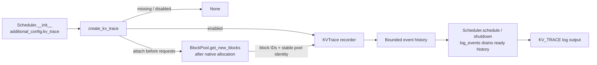

# KV Trace: Incremental Development

!!! note "First slice: native allocation observations"
    This slice connects configuration, the scheduler's native BlockPool and
    engine log output. It records successful allocations, not request bindings,
    reference-count transitions, KV contents or runner execution plans.

Enable allocation tracing for one engine:

```bash
vllm serve MODEL --additional-config '{"kv_trace":{"enabled":true}}'
```

Tracing is disabled by default. Enabled engines emit `KV_TRACE KVTraceBatch(...)`
records through vLLM's existing INFO logging. Existing logging configuration
still controls whether and where those messages are emitted.

KV Trace will connect native KV-cache lifecycle observations with request
bindings and runner address plans. Build and review it in small contributions
whose behavior can be tested independently.

## First slice: configuration, producer and consumer

`vllm/v1/kv_trace.py` has one concrete recorder, two immutable data records, and
an opt-in factory. It introduces no generic plugin framework, abstract backend,
background thread, device operation, or scheduler method wrapper.



| Component | Responsibility |
| --- | --- |
| `BlockAllocated` | Record sequence, pool, block ID and observed allocation generation. |
| `KVTrace` | Assign engine-local trace identity, sequence and allocation generations; retain at most 4,096 events by default. |
| `KVTraceBatch` | Return detached immutable events and the half-open range of events lost to retention overflow. |
| `create_kv_trace` | Parse `additional_config["kv_trace"]["enabled"]`; return no recorder when omitted or disabled. |

### Exact insertion points

| Native function | Position and action |
| --- | --- |
| `Scheduler.__init__` | Create the recorder from `vllm_config.additional_config`; after constructing the existing cache manager, attach it to `self.kv_cache_manager.block_pool`. |
| `BlockPool.set_kv_trace` | Assign a stable pool identity during scheduler initialization, before request allocations. |
| `BlockPool.get_new_blocks` | Record returned block IDs after eviction/reference updates and immediately before returning the native result. Failed allocations produce no success event. |
| `Scheduler.schedule` | After `_update_after_schedule`, drain pending allocation records through `KVTrace.log_events`. |
| `Scheduler.shutdown` | Flush pending records through the same consumer. |

These are direct calls in the native methods. There is no class replacement,
runtime method wrapping or per-layer attention hook. `touch` and `free_blocks`
keep their native behavior and do not advance allocation generations.

The factory accepts only a boolean `enabled` option. Unknown options and wrong
types fail explicitly, including when tracing is disabled. The retention limit
is an internal constructor parameter rather than another engine configuration
option in this first slice.

An allocation generation advances only when the caller reports a new native
allocation lifetime. Prefix sharing must not call `record_allocation`. Draining
events preserves generations and sequence numbers. Identical block IDs in
different pools, or in different recorder instances, have separate identities.
`BlockPool.set_kv_trace` assigns a distinct pool ID for each attached pool.

This component records observations; it does not decide whether the allocator
acted correctly. It tracks neither native reference counts nor initialized KV
contents. Missing history is reported as a gap, not reconstructed from later
allocations.

The recorder has one producer and consumer in the same engine thread. Retained
event count is bounded; the generation table grows with the number of distinct
pool/block identities observed. This is not a process-memory byte budget.
Concurrency and pool teardown beyond the scheduler-owned pool need separate
review. The enabled logging path adds host-side record and formatting cost;
this slice makes no throughput or latency guarantee.

## Design standards applied

The implementation follows specific patterns from reviewed upstream changes:

| Reference | Useful pattern | Application here |
| --- | --- | --- |
| [KV offload RFC](https://github.com/vllm-project/vllm/issues/19854), [component PR](https://github.com/vllm-project/vllm/pull/19848), [LRU follow-up](https://github.com/vllm-project/vllm/pull/20075) | Deliver a testable slice before adding more policies. | Keep the initial producer/consumer path limited to native allocation records. |
| [Endpoint plugin RFC](https://github.com/vllm-project/vllm/issues/46565), [implementation](https://github.com/vllm-project/vllm/pull/47454) | Keep the contract, opt-in gate and lifecycle explicit; exercise behavior at the appropriate entry point. | The factory is the component entry point; disabled tracing returns `None`, and real recorder objects test its behavior. |
| [Connector event extension](https://github.com/vllm-project/vllm/pull/19737) | Extend through a small `take_events` contract and cover composition points. | Collection has a typed drain boundary and a scheduler log consumer; worker/composite adapters remain separate. |

These are code-organization references, not dependencies or implementations of
KV Trace. Their abstraction counts are not a template: a single recorder does
not need an abstract base class, handler registry or sink factory hierarchy.

## Tests and next contributions

`tests/v1/core/test_kv_trace.py` exercises the factory, engine/pool isolation,
reallocation after drain, bounded retention, exact dropped-sequence reporting,
and detachment from mutable input, plus native allocation, reference changes,
reuse, failure and pool isolation. `test_scheduler.py` checks configuration
through the real scheduler. `test_kv_trace_e2e.py` enables/disables tracing through
`LLM` and checks actual allocation logs. Existing V1 Core CI selects these files.

1. **Allocation trace skeleton:** configuration, native allocation producer,
   bounded collection and log consumer in this change.
2. **Reference history:** add native reference/share/release observations and
   explicit teardown semantics; do not infer them from allocation records.
3. **Request history:** add scheduler binding deltas and scheduling-step context,
   with completion/preemption semantics and bounded export.
4. **MRV2 plans:** correlate final metadata once per cache group, including
   asynchronous snapshots and eager/FULL replay. No per-layer attention tracing.
5. **Diagnostics and coverage:** add supported address checks and then explicit
   layout/connector adapters, each with targeted runtime evidence.

Each contribution must describe its actual producer and consumer, disabled
cost, ownership/lifetime semantics, tests and remaining coverage. Fail-fast and
cache-correctness checks are outside this allocation-only slice.
